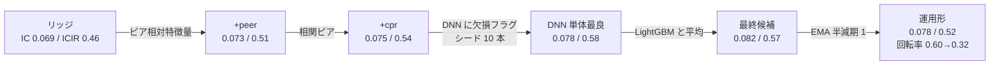
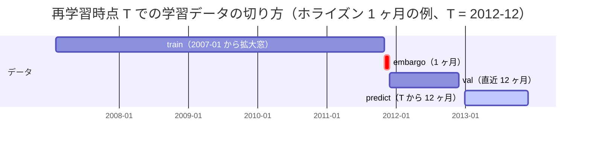
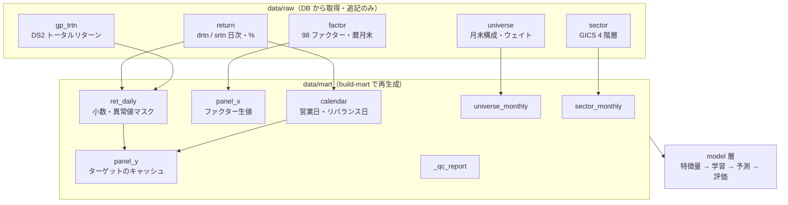
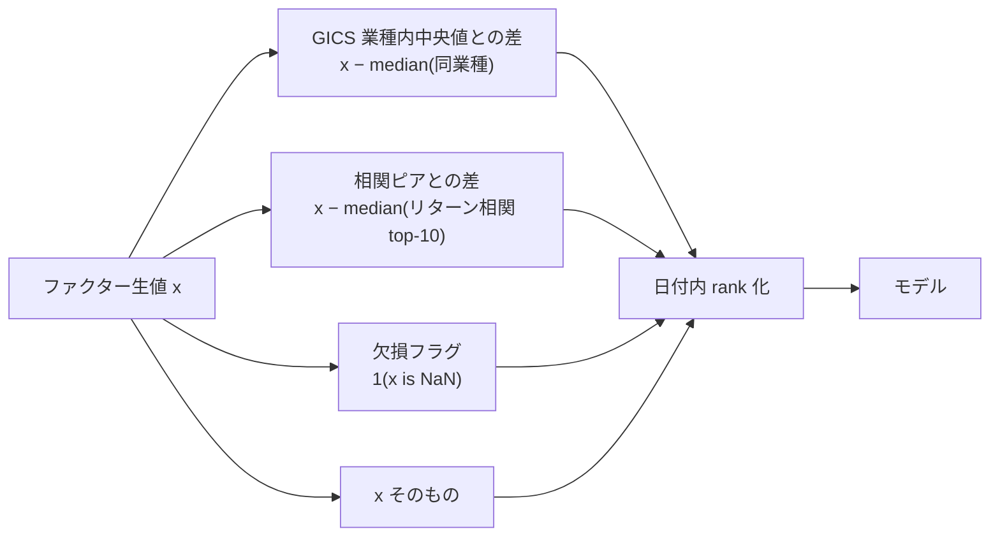
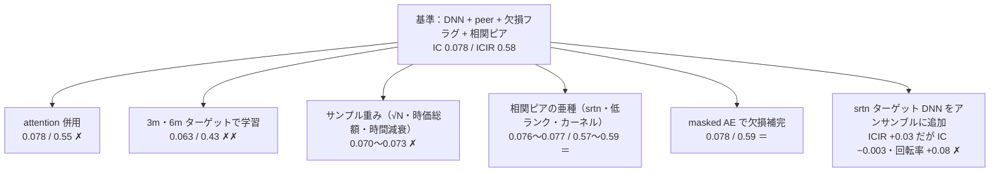

# インド株 AI スコア：モデル改善の経緯

MSCI India IMI（約 200〜680 銘柄）を対象に、月次リバランスで翌月リターンの順位を予測する AI スコアを構築した。
本資料は「なぜその順番で、何を試し、何を採用・不採用としたか」を説明する。数値はすべて 2012-12〜2026-08 のアウトオブサンプル（164 ヶ月、年 1 回再学習の walk-forward）。

## 1. 結果の要約

| | rank IC | ICIR | 分位スプレッド (月) | 回転率 (月, 片道) |
|---|---|---|---|---|
| 出発点：リッジ回帰 | 0.069 | 0.46 | 1.33% | 0.47 |
| 最終：LightGBM + DNN アンサンブル | **0.082** | **0.57** | **1.66%** | 0.60 |
| 同、平滑化後（EMA 半減期 1 ヶ月） | 0.078 | 0.52 | — | **0.32** |

IC で +19%、ICIR で +24%。改善の大半は**モデルではなく特徴量**（銘柄間の相対化）から来ている。

## 2. 問題設定と制約

- 評価は日付内の Spearman 相関（rank IC）。ターゲットは翌月トータルリターンの日付内 Gaussian rank。
- **本質的な制約は銘柄数ではなくクロスセクション数**。学習に使える独立な「日付」は約 235 本しかない。前任者のモデル（約 2,400 次元の特徴量、BN 付き 5 層 NN、検証セットなし）が機能しなかった教訓から、設計方針を「小さいモデル・少ない特徴量・厳密な検証」に置いた。
- 検証は年 1 回再学習の walk-forward。学習データはターゲットの終了日が再学習時点以前のものに限り、検証期間（直近 12 ヶ月）との間にホライズン分の embargo を置く。

## 3. データ基盤（1 日目）

モデルの前に、再現可能なデータ層を作った。

ここで見つかった論点と対応：

| 論点 | 対応 |
|---|---|
| 日次リターンは平日カレンダーで、祝日が「全銘柄 0%」として入っている | 営業日を「0% の銘柄比率 < 99%」で定義（NSE の祝日と一致） |
| ファクターは暦月末時点の値 | リバランス日を月末営業日に設定（1 営業日前だと 1 日先読みになる） |
| Barra リターンに未調整のコーポレートアクションの疑い | DS2 のトータルリターンと突合。月次相関 0.998 で基本的に調整済みと確認。残る疑わしい日（|ret| > 40% で DS2 が裏付けない 124 行）を欠損扱い |
| ユニバースが 2007 年以前は 15〜46 銘柄 | 学習開始を 2007-01 に |

## 4. ベースライン（1 日目）

同じ特徴量（93 ファクター ＋ ラグ・変化率 = 145 本、日付内 rank）で 3 種のモデルを比較した。

| モデル | IC | ICIR | 所見 |
|---|---|---|---|
| リッジ回帰（α を検証 IC で選択） | 0.069 | 0.46 | 強い基準 |
| LightGBM lambdarank | 0.051 | 0.35 | early stopping が数イテレーションで止まる。回帰目的に切替（0.067 / 0.47） |
| DNN（MLP 64-32、IC 損失、日付バッチ、5 シード） | 0.065 | 0.47 | **リッジに負ける** |

「DNN がベースラインを上回ることを確認する」という設計方針を、この時点では満たしていなかった。モデル容量を増やす方向ではなく、**特徴量に銘柄間の関係を入れる**方向を選んだ。

## 5. 銘柄間の関係性を特徴量にする（2 日目・最大の改善）

transformer のように銘柄間の関係を学習させる案が出発点だったが、クロスセクション 235 本で attention を学習するのは過学習が見えていた。そこで「attention が学ぶであろう関係」を手で特徴量にすることから始めた。

| 追加した特徴量 | リッジ | LightGBM | DNN | 判断 |
|---|---|---|---|---|
| 業種内ピア相対（19 本）＋業種中央値（7 本） | 0.073 / 0.51 | 0.072 / 0.52 | 0.074 / 0.54 | **採用**。3 モデル全てで改善し、DNN がリッジを上回る |
| リターン相関 top-10 ピア相対（19 本） | 0.075 / 0.54 | **0.077 / 0.55** | 0.075 / 0.56 | **採用**。木モデルで最大の効果 |
| 欠損フラグ（56 本 ＋ 欠損数） | 0.072 / 0.50 | 0.072 / 0.53 | **0.076 / 0.54** | **DNN のみ採用**。線形モデルには次元が多すぎ、木は欠損を元から扱える |

「アナリスト予想が存在しない」こと自体に情報があり（カバレッジ効果）、それをファクター値との交互作用で使えるのは非線形モデルの利点だった。

実際に attention も実装して比較した（1 ブロック・2 ヘッド・幅 32、10 シード）。結果は MLP と IC が同じ（0.078）、ICIR は低く（0.55 vs 0.58）、スコアの順位相関 0.965 で中身もほぼ同じモデル、学習時間 3.5 倍。**手作りのピア特徴量で取れる分は取り切っていた**。

## 6. 試して採用しなかったもの

同じ walk-forward・同じ評価で 1 点だけ変えて比較し、**シードノイズ（IC ±0.002、ICIR ±0.03）を超えない差は「同じ」**と判定した。シードノイズは、同一設定でシードの組だけ変えた 2 run の差から測った。

| 案 | なぜ試したか | なぜ採用しなかったか |
|---|---|---|
| 長期ターゲット（3m / 6m）で学習 | 日次ノイズの平均化で学習信号が強くなる、回転率も下がる | 1 ヶ月の IC が大幅に下がる。回転率の低下は EMA 平滑化のほうが IC を保てる |
| サンプル重み | 大型株の精度優先、直近重視 | 時価総額重みは小型株の順位精度を落として IC 低下。時間減衰は効果なし＝古いデータは害になっていない |
| 相関ピアの亜種 | Barra 残差（srtn）で「ファクター外の共変動」、低ランク化で縮小推定、カーネル重みで回転率低下 | 全て top-10 中央値と同じ結果。類似度の作り方は結果に影響しない |
| masked AE 補完 | 欠損ファクターを他ファクターから推定（R² 0.7 で復元できた） | 下流の IC は不変。補完に使う情報はモデルがすでに持っており、本当に欠けている情報（予想の中身）は復元できない |
| srtn ターゲット DNN の追加 | 固有リターン特化のメンバーで相関を下げ ICIR 改善 | ICIR +0.03 の代わりに IC −0.003、回転率 +0.08。回転率を揃えると優位性が消える |

## 7. アンサンブルと平滑化（最終形）

メンバー間の順位相関は 0.77〜0.83 と高く、分散低減（ICIR）の余地は小さかったが、IC は +0.004 上がった。

| 組み合わせ | IC | ICIR | 3m IC |
|---|---|---|---|
| DNN 単体 | 0.078 | 0.58 | 0.094 |
| LightGBM + DNN | **0.082** | 0.57 | **0.101** |
| リッジ + LightGBM + DNN | 0.082 | 0.57 | 0.101 |
| 同、過去 24 ヶ月 IC で動的加重 | 0.082 | 0.57 | 0.100 |

- リッジは DNN と相関 0.83 で情報が重複し、足しても変わらない。LightGBM は最も相関が低く（0.77）寄与が大きい。
- 動的加重は等ウェイトと一致（メンバーの実力差が小さい）。**等ウェイト固定**。

回転率は月 0.60（片道）と高い。スコアを銘柄ごとに EMA 平滑化すると：

| 半減期 | IC | ICIR | 回転率 |
|---|---|---|---|
| なし | 0.082 | 0.57 | 0.60 |
| **1 ヶ月** | **0.078** | **0.52** | **0.32** |
| 2 ヶ月 | 0.072 | 0.47 | 0.22 |

半減期 1 ヶ月で回転率 −47%、IC −5%。半減期 2 以降は IC の減りが回転率の減りに追いつかない（1 ヶ月前のスコアの IC が 0.057 と明確に低いため）。

## 8. 学んだこと

1. **N≈200〜600 のクロスセクションでは、モデルより特徴量の設計が効く。** attention・AE・重み付けは全て「同じ」か「悪化」、相対化特徴量は全モデルで一貫して改善した。
2. **シードノイズを先に測る。** 5 本アンサンブルの差 ±0.002 を知らなければ、attention や相関ピア亜種を「改善」と誤認していた。
3. **回転率は IC と同じ重さで見る。** 新しい特徴量は IC と同時に回転率も上げる。平滑化後の値で比較しないと、コスト後に負ける改善を採用してしまう。
4. **外部データとの突合はモデルより先。** リターンの異常値疑義は、DS2 との月次相関 0.998 で 1 時間で決着し、以後ターゲットの信頼性を疑わずに進められた。

## 9. 次の一手

今あるデータで試せることは概ね尽くした。差が出る見込みがあるのはデータが増える方向：

- **MSCI EM での事前学習 → インドで微調整**。クロスセクション数が 5 倍になれば、attention など容量の大きいモデルが初めて意味を持つ。
- **マクロ・レジーム条件付け**（政策金利、INR、FII フロー）。インドはフローでファクターの効きが反転しやすい。
- 取引コストの前提を入れた平滑化半減期の最適化。
